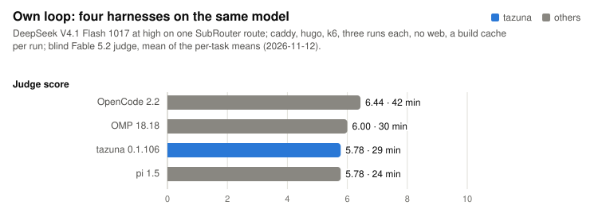

# tazuna (手綱)

A lean terminal coding agent for any model. Claude runs through the official `claude` CLI on
your own subscription; DeepSeek, GPT, Kimi, GLM, Mistral and others run on tazuna's own agent loop. Every change is
benchmarked before it stays.

[Install](#install) · [Results](#results) · [What it does](#what-it-does) · [Other models](#models-beyond-claude) ·
[Changelog](CHANGELOG.md) · [Roadmap](ROADMAP.md)

## Install

macOS and Linux:

```sh
curl -fsSL https://raw.githubusercontent.com/suwandre/tazuna/main/install.sh | sh
```

Windows (PowerShell):

```powershell
irm https://raw.githubusercontent.com/suwandre/tazuna/main/install.ps1 | iex
```

The binary goes to `~/.local/bin` (on Windows also onto your PATH; `TAZUNA_INSTALL_DIR` picks another folder), and
`tazuna update` replaces it with the newest release later. Releases have builds for macOS (Apple silicon, Intel), Linux
(x86_64, ARM) and Windows (x86_64).

You also need git, and for Claude the [`claude` CLI](https://docs.claude.com/en/docs/claude-code), logged in. On Windows,
Git for Windows too: like Claude Code there, tazuna runs commands in Git Bash. From source: `cargo install --path .`.

## Start

```sh
cd your-repo
tazuna                                          # Claude; the router picks model and effort
tazuna --model claude-sonnet-5-5 --effort high
tazuna -c                                       # continue this repo's last session
tazuna --run task.txt                           # one task, headless, result as JSON
```

Type a task and press enter. `/model` switches to another model mid-session (Claude or the own loop) and asks its effort
after, `/effort` changes only the effort (the conversation goes on), `/login` adds a provider's key, `/mcp` brings your
tools, `/keys` lists every key and command.

## Results

<picture>
  <source media="(prefers-color-scheme: dark)" srcset="docs/img/harnesses-dark.svg">
  
</picture>

<picture>
  <source media="(prefers-color-scheme: dark)" srcset="docs/img/own-loop-dark.svg">
  
</picture>

<picture>
  <source media="(prefers-color-scheme: dark)" srcset="docs/img/same-model-dark.svg">
  
</picture>

<picture>
  <source media="(prefers-color-scheme: dark)" srcset="docs/img/memory-dark.svg">
  
</picture>

In short: on Opus, tazuna 0.1.96 scores the same as Claude Code at 25% less cost and in about two thirds of the time.
On a cheap model, tazuna's own loop scores level with OMP, OpenCode and pi (within judge noise) but takes two to four
times as long; Command Code scores higher at twelve times the cost and runs past the time limit.

How to read these: tasks are real merged PRs (Go: caddy, hugo, k6, prometheus, terraform) with the PR's own tests hidden
from the agent, and a blind judge scoring every candidate for a task together (Opus 5.5 xhigh for the rounds shown here;
Fable 5.2 high from 2026-11-11 on). One run varies by about ±1.5 judge
points, so judge differences under 0.75 count as noise. All rounds since 2026-11-09 run on one Linux VM, every harness in
the same sandbox. Every measured change is in the [changelog](CHANGELOG.md); the kit is in [bench/](bench/README.md); the
charts come from [docs/charts.py](docs/charts.py).

<details>
<summary>The numbers as tables</summary>

Claude path, Opus 5.5 medium, six Go PRs × 3 runs, one judge pool per task (2026-11-11; Claude Code 2.1.322):

| Task | Claude Code | tazuna 0.1.96 | tazuna 0.1.95 |
|---|---|---|---|
| caddy | 8.33 · $0.50 | 8.00 · $0.48 | 8.00 · $0.45 |
| hugo (section slug) | 7.33 · $0.48 | 8.00 · $0.31 | 7.67 · $0.34 |
| hugo (template return) | 5.67 · $1.62 | 6.67 · $1.10 | 5.00 · $1.11 |
| k6 | 7.00 · $1.19 | 6.67 · $0.90 | 6.33 · $0.72 |
| prometheus | 7.67 · $1.06 | 6.67 · $1.09 | 7.33 · $0.85 |
| terraform | 4.00 · $0.68 | 4.00 · $0.26 | 4.00 · $0.34 |
| **all six** | **6.67 · $5.52 · 71 min** | **6.67 · $4.15 · 45 min** | **6.39 · $3.82 · 52 min** |

Low against medium effort, the same six PRs × 3 runs, judged per effort (2026-11-10; tazuna 0.1.93):

| Task | Claude Code low | tazuna low, no explorer | Claude Code medium | tazuna medium (default) |
|---|---|---|---|---|
| caddy | 8.00 · $0.29 | 5.00 · $0.16 | 8.33 · $0.49 | 8.00 · $0.43 |
| hugo (section slug) | 7.00 · $0.35 | 7.00 · $0.22 | 7.67 · $0.51 | 7.67 · $0.34 |
| hugo (template return) | 7.00 · $0.86 | 5.67 · $0.58 | 6.00 · $1.62 | 5.33 · $1.19 |
| k6 | 6.00 · $0.48 | 7.00 · $0.33 | 7.33 · $1.20 | 6.67 · $0.68 |
| prometheus | 7.67 · $0.64 | 8.00 · $0.53 | 7.67 · $1.02 | 7.33 · $0.91 |
| terraform | 5.00 · $0.40 | 5.00 · $0.26 | 4.67 · $0.68 | 4.00 · $0.34 |
| **all six** | **6.78 · $3.02** | **6.28 · $2.08** | **6.94 · $5.52** | **6.50 · $3.89** |

Medium adds about 0.2 judge points over low for either harness, at about 1.8× the cost.

Own loop, DeepSeek V4.1 Flash 1017 at high on one SubRouter route, three Go PRs (caddy, hugo, k6) × 3 runs
(2026-11-11). Judge is the mean of the per-task means:

| Harness | Judge | caddy / hugo / k6 | All hidden tests pass | Median minutes |
|---|---|---|---|---|
| OMP 18.18 (5 clean runs) | 5.89 | 8.67 / 5.00 / 4.00 | 3/5 | 10 |
| **tazuna 0.1.103** | **5.56** | 7.00 / 3.67 / 6.00 | **6/9** | **41** |
| OpenCode 2.2 | 5.44 | 7.33 / 4.00 / 5.00 | 5/9 | 14 |
| tazuna 0.1.96 | 5.11 | 7.33 / 3.33 / 4.67 | 5/9 | 35 |
| pi 1.5 | 5.00 | 8.00 / 2.00 / 5.00 | 5/9 | 11 |

Four of OMP's runs (hugo and k6, two each) read the merged upstream fix and its hidden tests from cdn.jsdelivr.net
and a Gitea mirror, which the bench's denylist did not cover; they scored 9 each and are left out. The same check
found four such runs in the 2026-11-09 round (OMP once, pi three times). Without them that round reads Command Code
7.75 (4 runs), OpenCode 6.33, tazuna 0.1.83 6.17, pi 6.00 (3 runs), OMP 5.17 (5 runs), where it had shown tazuna, pi
and OMP level at 6.17. Agents in the bench now get no web at all, and leakscan flags any transcript that holds the
hidden tests' names.

Same model, its maker's harness, four Go PRs, one run each:

| Model | Harness | Judge | Hidden tests | Minutes per task | Cost per task |
|---|---|---|---|---|---|
| DeepSeek V4.1 Flash (Mistral's API) | **tazuna 0.1.73** | **8.00** | **11/11** | **7** | ~$0.06-0.35 |
| | Mistral Vibe CLI 3.1, max | 7.50 | 10/11 | 21 | plan usage |
| Kimi K3.1 Pro (SubRouter) | **tazuna 0.1.4** | 6.88 | 11/13 | **14.3** | **$0.05** |
| | Kimi Code 2.4.0 | 7.25 | 11/13 | 20.5 | $0.11 |

Earlier round, eight harnesses on Claude Sonnet 5.5 high, six Go PRs × 2 runs (2026-10-07, tazuna 0.0.11): tazuna 6.67,
OMP 6.54, Claude Code 6.38, Hermes 6.21, pi 6.08, tazuna lean 6.04, OMO 5.38, Empryo 5.12 (judge; median cost
$0.28-0.55 a task).

Footprint: binary 4.4 MB; UI 7.8 MB RAM, ~2% CPU while animating, first frame in 8 ms (tazuna 0.1.83). Claude Code's own
UI: 190 MB, 0.45 s to start (2026-10-08). A whole agent run: 21-22 MB on the own loop, 262-282 MB on the claude CLI
(tazuna 0.0.50).

</details>

## What it does

- **Two paths, one UI.** Claude runs through the official `claude` CLI, headless, on your subscription: no token reuse,
  no impersonation. Every other model runs on tazuna's own loop, on any OpenAI-compatible, Responses or Anthropic
  Messages API. A task the cheap model cannot finish can go to Opus (on by default with `--provider`; `--no-escalate`).
- **Verified, not claimed.** When the agent says it is done, tazuna runs the tests and type checks for what changed and
  sends failures back, up to two rounds. Type errors from an edit come back right after the edit.
- **Lean by default.** The router puts tiny repos on Sonnet and the rest on Opus at medium effort. Repos with agent
  config run Claude Code's own prompt with the repo's settings, hooks and skills; others run a ~10-line prompt with four
  tools. Long command output is cut to its start and end. Boss mode (`/boss`; the default for `--run` on Opus) lets Opus
  direct while Haiku workers read, edit and test.
- **MCP for every model.** `/mcp add atlassian https://mcp.atlassian.com/v1/mcp`, then `/mcp on`, and "fix ABC-123" is
  enough. Servers that need a login get one in the browser, as tazuna itself; on Claude your claude.ai connectors come
  along. The list is `~/.config/tazuna/mcp.json`, in Claude Code's format.
- **A terminal UI that stays small.** Four designs (`ctrl-t`; the default cockpit shows context, cache, cost, tools and
  files as they change), click and drag in the message box, `@` for files, images with `ctrl-v`, `!cmd` for the shell,
  `/diff`, `/rewind`, `/resume`, and permission modes on `shift-tab` (auto, ask, edits, plan).
- **Recordings.** Every session is saved to `~/.local/share/tazuna/sessions/` and replays like a video:
  `tazuna <file>.jsonl`.
- **And:** `/loop` builds the open items of a `TODO.md` one by one, `/jira ABC-123` puts a ticket in the message without
  MCP, `--review-model` adds an independent reviewer, `tazuna --log` shows the run log.

## Models beyond Claude

`/model` shows the providers on the left and the selected one's models on the right, with prices and benchmark
scores; typing searches every provider at once. A provider without a key is greyed out until you log in: `/login` lists
the providers, and picking one opens the page where its keys are made in your browser and asks for the key. tazuna keeps
it in `~/.config/tazuna/keys.json` (readable by you only) and puts the provider on `~/.config/tazuna/trusted-providers`,
since it will see your code. A key in the environment (`MORTERA_API_KEY` and so on) still works and wins.

- **SubRouter** (DeepSeek, GPT, Kimi, GLM, MiniMax ...): your own key, or `tazuna subrouter --manage` makes one with the
  providers tazuna checked (they differ a lot: some serve another model, some barely cache); `tazuna subrouter --apply`
  sets them on your own key.
- **Mistral**: an API key, or one made under Code › Vibe CLI.
- **Mortera** (Gemini, GPT, Kimi, Grok, Qwen, GLM, DeepSeek ... at reseller prices): once its key is in, `/model` lists
  every text model on its list, as not checked yet.
- **OpenRouter**: every model on its list that takes tools (about 300), newest free ones first, then the newest paid
  ones. Free models are rate-limited, and their providers may keep or train on your code.
- **Kenari** (a gateway priced in rupiah): every chat model on its list that takes tools (76), the free ones first (5 calls
  a minute and 50 a day without a top-up), each with its own effort levels.
- **Anything else** OpenAI-compatible: `--provider URL --key-env VAR --model ID` (its host on the trusted list, or
  `--data any`).

## Safety

- tazuna expects a git repo: in auto mode the agent edits and runs commands without asking, and `git diff` is the
  review. Outside a repo it starts in ask mode.
- A repo's `CLAUDE.md` / `AGENTS.md` go into the prompt; a repo whose config runs code (hooks, skills) asks "Trust this
  repo?" once. In repos you did not write, add `--no-project-instructions`.
- On the own loop the provider key never reaches the agent's commands, and keys saved in tazuna (and the managed
  SubRouter key) are never put in tazuna's environment. Keys you export in your shell are visible to Claude's commands,
  as in any terminal. MCP logins sit
  in `~/.config/tazuna/mcp-auth/`, readable by you only.

## Development

`cargo build --release`, `cargo test`. [ROADMAP.md](ROADMAP.md) holds the goals, the order of work and what was tried
or ruled out; [CHANGELOG.md](CHANGELOG.md) every change with its numbers; [bench/README.md](bench/README.md) the
benchmark kit.
